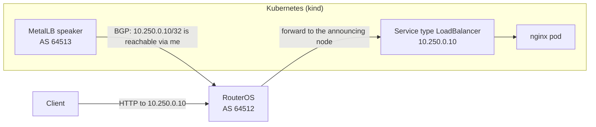
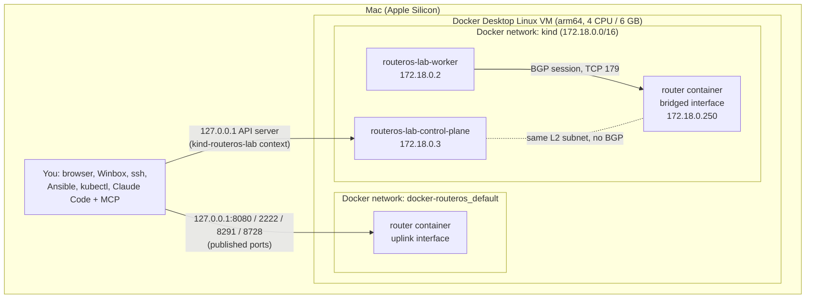
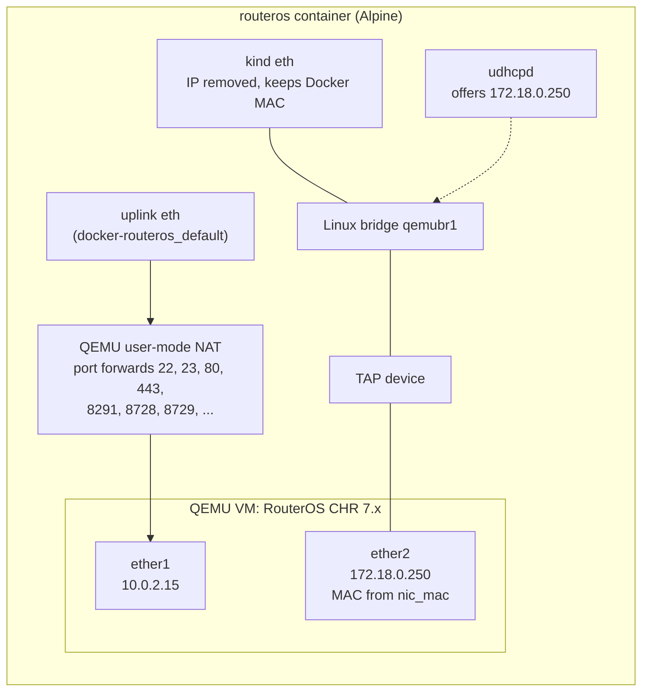
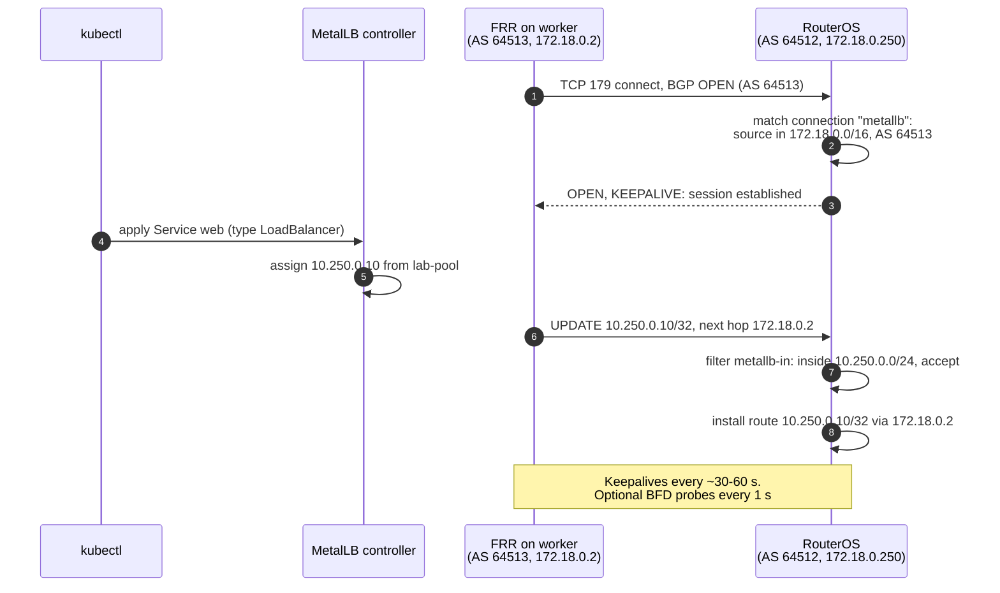
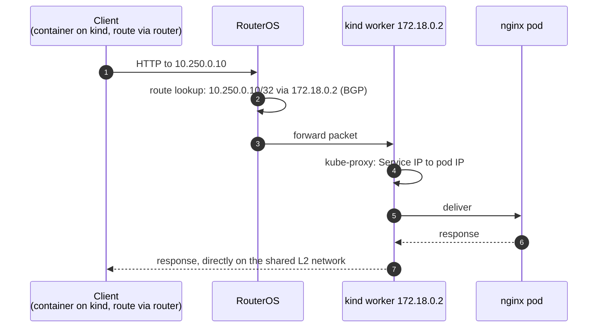
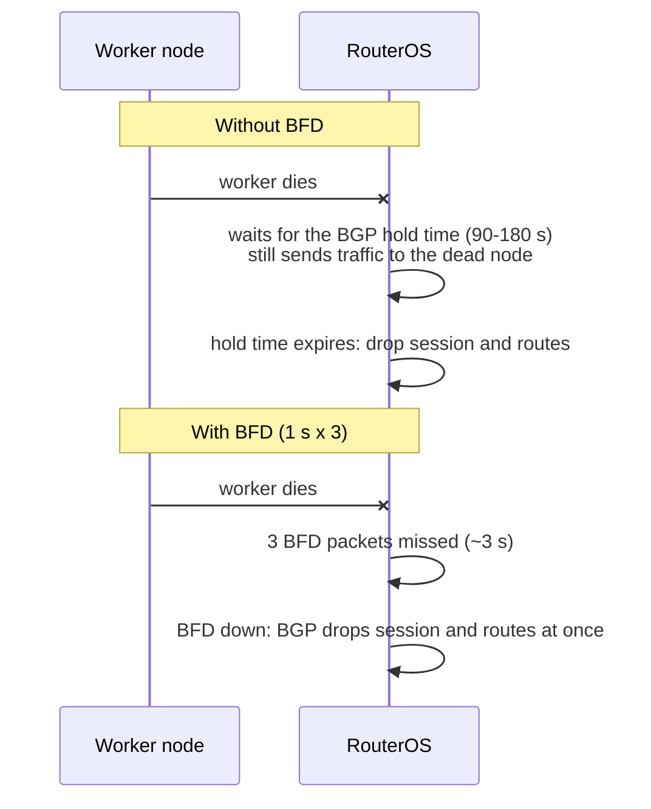
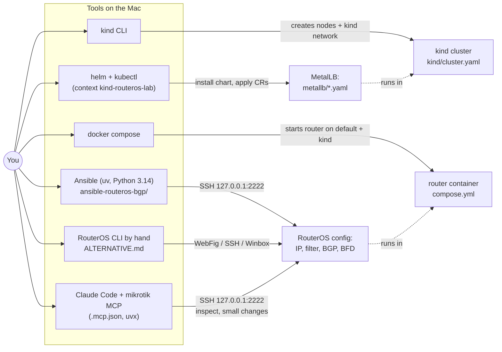
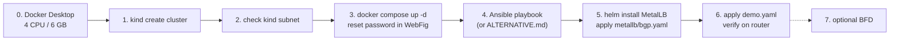

# Architecture

## Goal

This repository runs a **MikroTik RouterOS** router in Docker (the upstream
`docker-routeros` image). This fork adds a home lab around it: a Kubernetes cluster whose
**MetalLB** load balancer announces Service IPs to that router over **BGP**, the way a
bare-metal cluster announces them to a physical top-of-rack router.

What the lab lets you practise:

- RouterOS 7 BGP: instances, connections, route filters, ECMP (multipath), BFD
- MetalLB in BGP mode (FRR-K8s backend): `IPAddressPool`, `BGPPeer`, `BGPAdvertisement`, `BFDProfile`
- Configuring a router as code (Ansible) and by hand (RouterOS CLI)
- Following a packet from a client, through the router, to a pod

Everything runs on one Apple Silicon Mac inside Docker Desktop, so there is no extra
hardware.

## Topology

### Containers and networks

The router container joins **two** Docker networks (`compose.yml`):

| Network | Purpose | Inside RouterOS |
| --- | --- | --- |
| `docker-routeros_default` | Uplink. Carries the ports published to the Mac (`gw_priority: 1` keeps it the default route) | `ether1`, `10.0.2.15/24` behind QEMU's NAT |
| `kind` (external) | Shared with the Kubernetes nodes, so the router and the nodes are on one LAN | `ether2`, `172.18.0.250/16` |

### Inside the router container

RouterOS is not a container image; it is a VM (RouterOS CHR, x86_64) that QEMU runs
**inside** the container. On Apple Silicon QEMU emulates the x86 CPU (no KVM), which is
why the router is slow to boot and is kept small (1 vCPU, 256 MB).

The entrypoint (`scripts/entrypoint.sh`) builds this at start-up:

1. Finds the uplink: the interface with the IPv4 default route. It stays untouched, so the
   published ports keep working through QEMU's NAT.
2. Takes the other interface (the `kind` one), removes its IP and puts it into the bridge
   `qemubr1`. It keeps its Docker-assigned MAC. This needs `cap_add: NET_ADMIN`.
3. Starts QEMU with a second NIC on a TAP device attached to that bridge. The guest NIC
   (`ether2`) gets the MAC stored in `routeros_data/nic_mac`. This needs
   `devices: /dev/net/tun`.
4. Runs a one-lease DHCP server that offers the container's own kind address to the guest.

The result: the address Docker assigned on the kind network (`172.18.0.250`) now belongs
to RouterOS's `ether2`, which sits on the same L2 segment as the kind nodes.

The bridge port and the guest must have **different** MACs. The upstream image's entrypoint
gives the bridge port the guest's MAC; the bridge then treats frames for the guest as its
own and drops them, so ARP works but no unicast traffic (BGP, SSH) reaches RouterOS.
`compose.yml` therefore mounts this repository's fixed `scripts/entrypoint.sh` over the
image's copy.

## Addressing and numbers

| Item | Value | Defined in |
| --- | --- | --- |
| kind network | `172.18.0.0/16`, gateway `172.18.0.1` | Docker (chosen when the cluster is created) |
| Router on kind | `172.18.0.250` (`ether2`) | `compose.yml`, `ansible-routeros-bgp/group_vars/routeros.yml` |
| kind worker / control-plane | `172.18.0.2` / `172.18.0.3` | Docker (assigned by kind) |
| Router management | `10.0.2.15` (`ether1`, QEMU NAT) | QEMU defaults |
| LoadBalancer pool | `10.250.0.10-10.250.0.50` | `metallb/bgp.yaml` |
| Prefixes the router accepts | inside `10.250.0.0/24` | `group_vars/routeros.yml` (`metallb_pool_prefix`) |
| Pod / Service subnets | `10.244.0.0/16` / `10.96.0.0/16` | `kind/cluster.yaml` |
| Router AS | `64512` | `group_vars/routeros.yml`, `metallb/bgp.yaml` (`peerASN`) |
| MetalLB AS | `64513` (eBGP) | `metallb/bgp.yaml` (`myASN`), `group_vars/routeros.yml` |

The pool is deliberately **outside** the kind subnet. If it were inside, clients would
reach the IPs directly over L2 (ARP) and BGP would play no part.

### Ports published to the Mac

All bound to `127.0.0.1` only.

| Mac | Router service |
| --- | --- |
| `127.0.0.1:8080` | WebFig (HTTP 80) |
| `127.0.0.1:2222` | SSH (Ansible, MCP server, your terminal) |
| `127.0.0.1:2223` | Telnet |
| `127.0.0.1:8291` | Winbox |
| `127.0.0.1:8728` / `8729` | RouterOS API / API-SSL |

## How BGP works here

### Session and route announcement

The router only listens (`listen=yes connect=no`) for any address in the kind subnet.
MetalLB's FRR (FRR-K8s mode) on the worker node opens the session. The `BGPPeer`'s
`nodeSelectors` keep the control-plane node from peering, because kind excludes it from
announcing LoadBalancer IPs.

### Traffic path

The return traffic does not pass through the router: the worker and the client are on the
same subnet, so the worker answers directly (asymmetric routing). That is fine for this lab,
because the router has no stateful firewall rules.

The Mac itself cannot reach `10.250.0.x`: Docker Desktop does not route from macOS into its
networks. Test from the router (`/tool/fetch`) or from a container on the `kind` network
that routes `10.250.0.0/24` via `172.18.0.250` (see `NOTES.md`, step 6).

### Failure detection: BGP alone vs BFD

BFD is off by default. It needs MetalLB's FRR or FRR-K8s mode, `metallb/bfd.yaml`, and
`bfd_enabled: true` in the Ansible vars. The timers are relaxed (1 s × 3) because the
emulated router can miss shorter intervals and flap.

## Who configures what

Set-up order matters, because each step needs the previous one:

- The `kind` network must exist before the router container can join it (step 1 before 3).
- `ether2` must exist before Ansible can configure it (step 3 before 4).
- MetalLB's CRDs must be installed before `bgp.yaml` can be applied (Helm before `kubectl apply`).

The full commands are in `NOTES.md`, section 4.

## Repository map

| Path | Role |
| --- | --- |
| `Dockerfile`, `scripts/` | Upstream image: Alpine + QEMU + RouterOS CHR, and the entrypoint that builds the bridge |
| `compose.yml` | This lab's router: resource limits, two networks, published ports |
| `docker-compose.dist.yml` | Upstream example compose file |
| `routeros_data/` | Volume: `nic_mac` (bridged NIC MAC) and `disk2.raw` (second disk) |
| `kind/cluster.yaml` | Kubernetes cluster: 1 control-plane + 1 worker |
| `metallb/` | `bgp.yaml` (pool, peer, advertisement), `bfd.yaml` (optional), `demo.yaml` (test app) |
| `ansible-routeros-bgp/` | uv project with the playbook that configures RouterOS; `ALTERNATIVE.md` has the same steps as CLI commands |
| `.mcp.json` | MikroTik MCP server for Claude Code (password comes from the environment) |
| `NOTES.md` | Concepts (BGP, BFD, FRR) and the step-by-step lab guide |

## Design decisions

| Decision | Why |
| --- | --- |
| kind instead of minikube | Nodes share Docker's memory instead of reserving ~1.8 GB each; the cluster is a YAML file in the repo |
| eBGP (64512 ↔ 64513) | MetalLB's documented default; no iBGP route-reflection rules to think about |
| Router listens on the whole kind subnet | New worker nodes peer without router changes |
| Route filter on input | The router accepts only the LoadBalancer pool, nothing else a node might announce |
| Pool outside the kind subnet | Forces traffic through BGP routing instead of L2 |
| FRR-K8s mode (Helm default) | Supports BFD; native mode does not |
| Ansible over SSH with RouterOS scripts | The installed `community.routeros` API modules lacked the RouterOS 7.20+ BGP fields (`instance`, `multipath`, `use-bfd`); CLI commands work on any version |
| Objects tagged `managed by ansible: <key>` | Lets the playbook (and hand-made config from `ALTERNATIVE.md`) be re-applied without duplicates |
| Everything bound to `127.0.0.1` | The router starts with an empty `admin` password |

## Limitations

- **Slow router.** RouterOS is emulated x86 on ARM: 2-4 minute boots, higher CPU than real hardware.
- **1 Mbps per interface.** The free RouterOS CHR licence limits throughput; fine for
  configuration practice, not for performance tests.
- **Router config is not persistent.** The RouterOS system disk lives in the container,
  not in `routeros_data/`. Recreating the container (`docker compose down/up`, compose
  changes, image updates) resets RouterOS: empty password, no config, new SSH host key.
  Re-apply with Ansible or `ALTERNATIVE.md`.
- **No access from macOS to LoadBalancer IPs.** Docker Desktop does not route into its
  networks; test from the router or from a container on the `kind` network.
- **Subnet depends on Docker.** kind's network subnet is picked when the cluster is created.
  If it is not `172.18.0.0/16`, update `compose.yml`, the Ansible vars and `metallb/bgp.yaml`.
